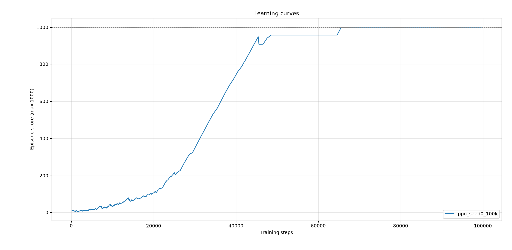

# Adewale
## GDG Robotics Track Assignment #1

- **Date: 22nd November 2026** 
- **Operating system and Python version:** Windows 11, Python 3.11.9
- **Algorithm and environment:** PPO, venv
- **What I changed from the starter pack:** nothing

## Training curve

## What I noticed

The model started learning slowly but quickly started to improve between 20000-50000 before evetually reaching a stand still for the next about 15000 attempts before eventually reaching the goal before 70000

## Problems I hit (optional)

I faced some trouble when trying to run the codes on the new virtual environment, but i later checked online and learned how to sort it out

I also originally saved the training curve as a .png file but i noticed it was'nt showing so i had to change it to .jpg