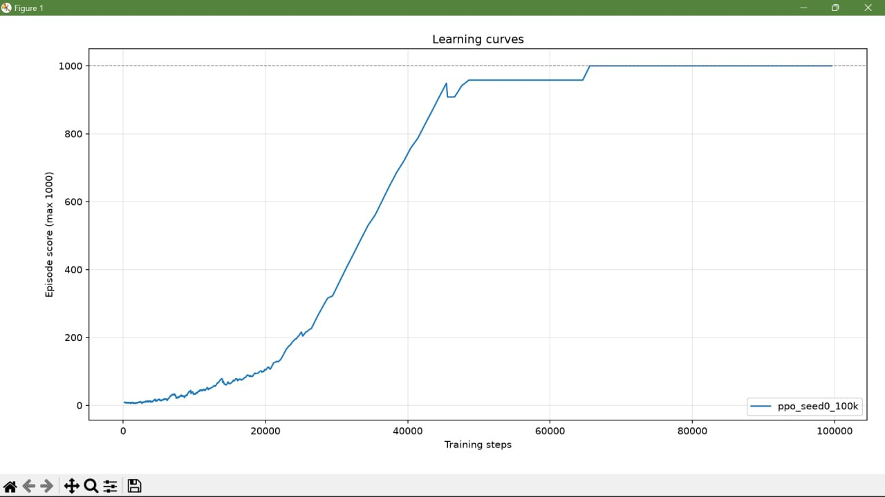

# [Your name or nickname]
## GDG Robotics Track Assignment #1

- **Date:** 
- **Operating system and Python version:** 
- **Algorithm and environment:** PPO, [environment name]
- **What I changed from the starter pack:** (nothing, or e.g. seed, learning rate, training steps)

## Training curve

## What I noticed

Two or three sentences. When did it start balancing? Was learning smooth or jumpy? Did anything surprise you?

## Problems I hit (optional)

Anything that went wrong while installing, training, or submitting. This helps improve the guide.