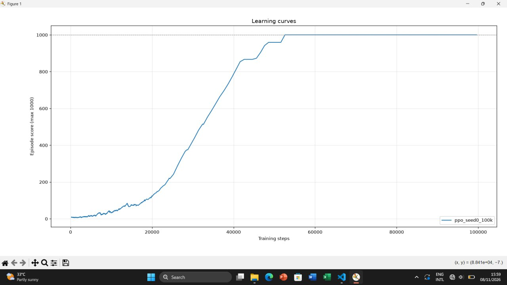

# Tobi-glitch-stack
## GDG Robotics Track Assignment #1

- **Date: 20th November, 2026**  
- **Operating system and Python version: Windows | Python 3.15** 
- **Algorithm and environment: PPO on CartPole-v1** 
- **What I changed from the starter pack:(nothing)**

## Training curve

## What I noticed

## Run Details
- **Algorithm & Run:** PPO (`ppo_seed0_100k`)
- **Seed & Duration:** Seed `0`, trained for `100,000` steps (max episode score: `1000`)

## Observations
- **Early Phase (0–20k steps):** Learning started slowly, rising from near `0` to about `100` as the agent explored initial actions.
- **Main Learning Phase (20k–42k steps):** Performance increased rapidly and smoothly from `~100` to `~860`.
- **Convergence (42k–53k steps):** After two short plateaus around `865` and `960`, the agent reached the `1000` maximum score at roughly `53,000` steps.
- **Stability (53k–100k steps):** Once solved, the policy remained completely stable at `1000` for the rest of the run without any dips.

## Problems I hit (optional)

I had some issues cloning the repository and trying to push my submission to github. I turned to my favourite LLM, and it guided me through the steps. Some failure points include:

- **Matching labels for learning curves** : Ensure you saved the screenshot as one word, or at best two or three words joined together with hyphens or underscores. Also remember to update the name changes in your notes.md file, as appropriate.

- **Git pushing**: when you get to submitting your...submission, recognise that git commands only work in the gdg-roboticsresources folder. If you somehow find yourself anywhere outside that, use the terminal command `cd ______` to navigate downward. For example if gdg-roboticsresources was nested in documents and your active path was users. Type out cd documents, then cd gdg-roboticdresources respectivelly. 

Also, VS code might need you to input the email address linked to your Github and your username. Do so using the commands `git config --global user.email "your email"` and `git config --global user.name "your github name"`  

